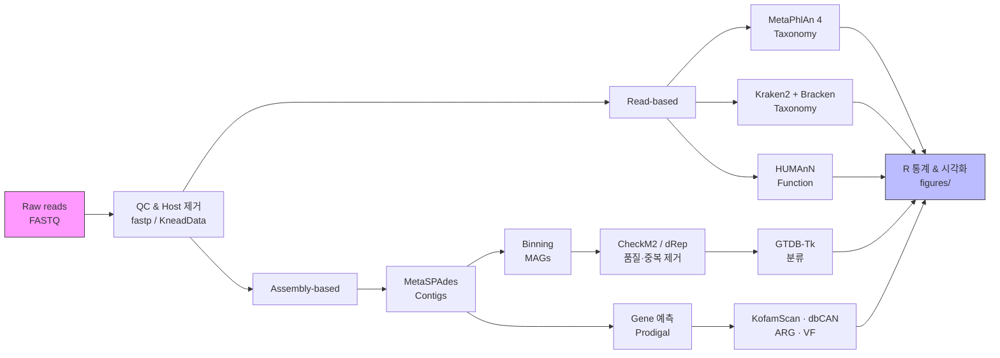
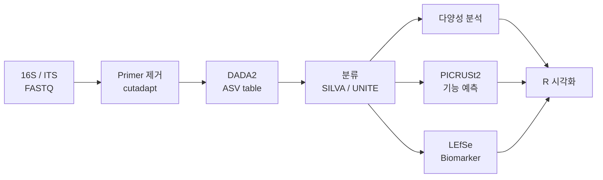

<div align="center">

# 🦠 Microbiome Bioinformatics Lab Notebook

**마이크로바이옴 생물정보학(BI) 분석 스크립트와 연구 기록을 모아두는 저장소**

<br/>


</div>

---

## 📌 소개

마이크로바이옴을 공부하는 대학원생의 **분석 파이프라인, 재사용 스크립트, 실험·분석 기록**을 정리하는 공간입니다.

- 🔁 **재현성**: 같은 분석을 나중에 다시 돌릴 수 있도록 명령어, 파라미터, 툴 버전을 남깁니다.
- 🧭 **기록**: 무엇을 왜 했는지, 어떤 결과가 나왔는지 날짜별로 남깁니다.
- 🧰 **재사용**: 자주 쓰는 코드는 템플릿으로 다듬어 `scripts/`에 모읍니다.

> ⚠️ 이 저장소에는 **원시 데이터, 참조 DB, 서버 경로, 개인·환자 정보를 올리지 않습니다.** 자세한 규칙은 [기록 원칙](#-기록-원칙)을 보세요.

---

## 🔬 분석 영역

<table>
<tr>
<td width="50%" valign="top">

### 🧬 Shotgun Metagenomics
- **QC / Host 제거**: fastp, KneadData
- **Taxonomic profiling**: MetaPhlAn 4, Kraken2 + Bracken
- **Functional profiling**: HUMAnN (pathway, gene family)
- **Assembly**: MetaSPAdes / MEGAHIT
- **Binning → MAG**: MetaBAT2 등, CheckM2, dRep
- **MAG 분류**: GTDB-Tk
- **기능 주석**: KofamScan (KEGG KO), dbCAN (CAZyme)
- **저항성·병원성**: ARG (CARD/RGI, AMRFinderPlus), VF (VFDB)

</td>
<td width="50%" valign="top">

### 🧫 Amplicon (16S rRNA / ITS)
- **전처리 & ASV**: QIIME 2 / DADA2
- **분류**: SILVA (16S), UNITE (ITS)
- **기능 예측**: PICRUSt2
- **Biomarker**: LEfSe
- **다양성**: α-diversity, β-diversity (Bray–Curtis, UniFrac)

### 📊 통계 & 시각화 (R)
- phyloseq, vegan, microeco
- ggplot2, ComplexHeatmap
- PERMANOVA, differential abundance (MaAsLin2, ANCOM-BC2)

</td>
</tr>
</table>

---

## 🗺️ 분석 흐름 한눈에 보기





---

## 🧰 툴 스택

| 단계 | 도구 | 비고 |
|---|---|---|
| QC | `fastp`, `FastQC`, `MultiQC` | 리포트는 요약만 기록 |
| Host 제거 | `KneadData`, `Bowtie2` | |
| Taxonomy (read) | `MetaPhlAn 4`, `Kraken2`, `Bracken` | DB 버전 꼭 기록 |
| Function (read) | `HUMAnN` | ChocoPhlAn / UniRef90 |
| Assembly | `MetaSPAdes`, `MEGAHIT` | |
| Binning / QC | `MetaBAT2`, `CheckM2`, `dRep` | |
| MAG taxonomy | `GTDB-Tk` | GTDB release 기록 |
| 기능 주석 | `Prodigal`, `KofamScan`, `dbCAN` | KEGG KO, CAZyme |
| ARG / VF | `RGI (CARD)`, `AMRFinderPlus`, `VFDB` | |
| Amplicon | `QIIME 2`, `DADA2`, `cutadapt` | |
| 기능 예측 | `PICRUSt2` | |
| Biomarker | `LEfSe`, `MaAsLin2`, `ANCOM-BC2` | |
| 통계·시각화 | `R`: phyloseq, vegan, ggplot2 | |

툴 설치 환경 예시는 [`envs/`](envs/)에, 짧은 사용법 메모는 [`docs/cheatsheet.md`](docs/cheatsheet.md)에 있습니다.

---

## 📁 폴더 구조

```text
claude_main/
├── README.md               ← 지금 보고 있는 문서
├── pipelines/              ← 단계별 분석 흐름 설명 (무엇을 어떤 순서로)
│   ├── shotgun/
│   └── amplicon/
├── scripts/                ← 실제로 돌리는 재사용 코드
│   ├── shotgun/            ← MetaPhlAn, HUMAnN, Kraken2 ... 실행 템플릿
│   ├── amplicon/           ← DADA2, PICRUSt2, LEfSe ...
│   ├── R/                  ← 통계 & 피겨 스크립트
│   └── utils/              ← 테이블 병합·변환 같은 소도구
├── notes/                  ← 분석 기록 (연구 노트)
│   ├── templates/          ← 노트 템플릿
│   └── logs/               ← 날짜별 분석 로그 (YYYY-MM-DD_주제.md)
├── figures/                ← 최종 피겨 (PNG/PDF, 작은 용량만)
├── envs/                   ← conda 환경 파일
└── docs/                   ← 툴 치트시트, 참고 자료
```

---

## 📝 기록 원칙

1. **날짜별 로그**: 분석할 때마다 `notes/logs/YYYY-MM-DD_주제.md`를 만들고 [분석 노트 템플릿](notes/templates/analysis_log_template.md)을 복사해서 씁니다.
2. **명령어 + 버전**: 실행한 명령어, 툴·DB 버전을 그대로 붙여 넣습니다.
3. **경로는 변수로**: 스크립트 안의 서버 경로는 `${DB_DIR}`, `${OUT_DIR}`처럼 변수로 두고 실제 값은 올리지 않습니다 (`*.local.*` 파일은 `.gitignore`에 포함).
4. **데이터는 밖에**: FASTQ, BAM, DB, 어셈블리 결과는 커밋하지 않습니다. 작은 요약 테이블과 피겨만 올립니다.
5. **커밋 메시지**: `[영역] 내용` 형식을 씁니다.
   - `[shotgun] HUMAnN 실행 스크립트 추가`
   - `[R] β-diversity PCoA 피겨 스크립트`
   - `[notes] 2026-11-26 MAG binning 결과 기록`

---

## 📚 공부 기록

| 날짜 | 주제 | 기록 |
|---|---|---|
| 2026-11-26 | 저장소 시작 🎉 | [notes/logs/2026-11-26_repo-setup.md](notes/logs/2026-11-26_repo-setup.md) |
| | | |

---

<div align="center">

*Sequencing reads → biological insight, one commit at a time.* 🧪

</div>
